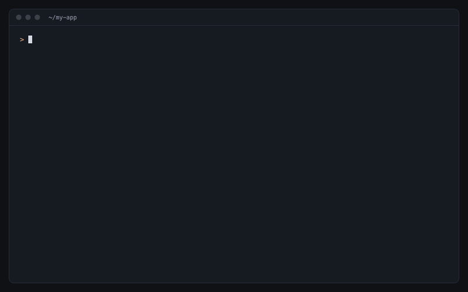

# BetterPrompt

A skill for [Claude Code](https://claude.com/claude-code) and other coding agents that turns a rough request into a sharp, complete prompt before Claude acts on it.



Claude writes very good prompts for its own subagents: exact inputs, settled decisions, scope, criteria, what to do when something is missing, and an output format. Most people don't type prompts like that. BetterPrompt has Claude do it for you, then lets you choose.

## How it works

1. **Finds what you actually want.** Claude reads the files, folder or URL you mention so the prompt names real paths and names.
2. **Asks about your stack** when you're starting a new project: platform and codebase, database, authentication and payments, with a recommended pick for each and room to name your own.
3. **Writes 2-3 rewrites.** Each one is a complete prompt, and they differ in how they get the job done (scope, depth, order), not just wording.
4. **You pick.** Choose one, ask for different options, or type what to change. Each card also says what was added to your request, so you learn to write it that way yourself.
5. **Remembers when you overrule it.** If you pick something other than its recommendation, it notes that and recommends your choice next time.
6. **Claude runs it** as if you had typed the better prompt yourself.

## Install

### Claude Code

```text
/plugin install betterprompt --marketplace fayofye/betterprompt
```

On Claude Code older than 2.1.275, run `/plugin marketplace add fayofye/betterprompt`, then `/plugin install betterprompt@betterprompt`. As a plugin the command is `/betterprompt:betterprompt`.

For the shorter `/betterprompt`, install it as a plain skill instead:

```bash
git clone https://github.com/fayofye/betterprompt ~/.claude/skills/betterprompt
```

To install it for one project only, clone it into `.claude/skills/betterprompt` inside that project.

### Codex

```bash
npx skills add fayofye/betterprompt --global --agent codex
```

### Other agents

```bash
npx skills add fayofye/betterprompt --global --agent '*'
```

This uses the [Skills CLI](https://skills.sh) to install it for every agent it supports. Leave off `--global` to install it only in the current project. For any other agent, copy `SKILL.md` into its skills folder. Agents without a pick-an-option tool get the options as a numbered list.

Start a new session after installing.

## Use

```text
/betterprompt the app feels slow, fix it
```

Claude also uses it when you ask it to improve, rewrite or sharpen a prompt, or when you start a new project.

## Example

You type:

> check if the signup flow works

One of the options you get back:

> Test the signup flow of the app in this repo end to end and report what breaks.
>
> Inputs: the signup page at `app/signup/page.tsx` and its API route `app/api/signup/route.ts`. Read both in full.
> Scope: test only; do not edit any file.
> Criteria: 1. a valid signup creates an account and logs in; 2. duplicate email, weak password and empty fields show a clear error; 3. no errors in the server log.
> If stuck: if the dev server won't start, report the error instead of testing partially.
> Output: a pass/fail line per criterion, then each failure with steps to reproduce. Under 300 words.

## Your preferences

When you overrule a recommendation, BetterPrompt saves a one-line note such as "web apps: SvelteKit over Next.js" to `~/.claude/betterprompt/preferences.md` on your machine. It stores choices only, never your requests, files or secrets. Delete the file to reset, or tell Claude not to remember.

## Update

- Plugin: `/plugin marketplace update betterprompt`
- Plain skill: `git -C ~/.claude/skills/betterprompt pull`

## License

MIT
